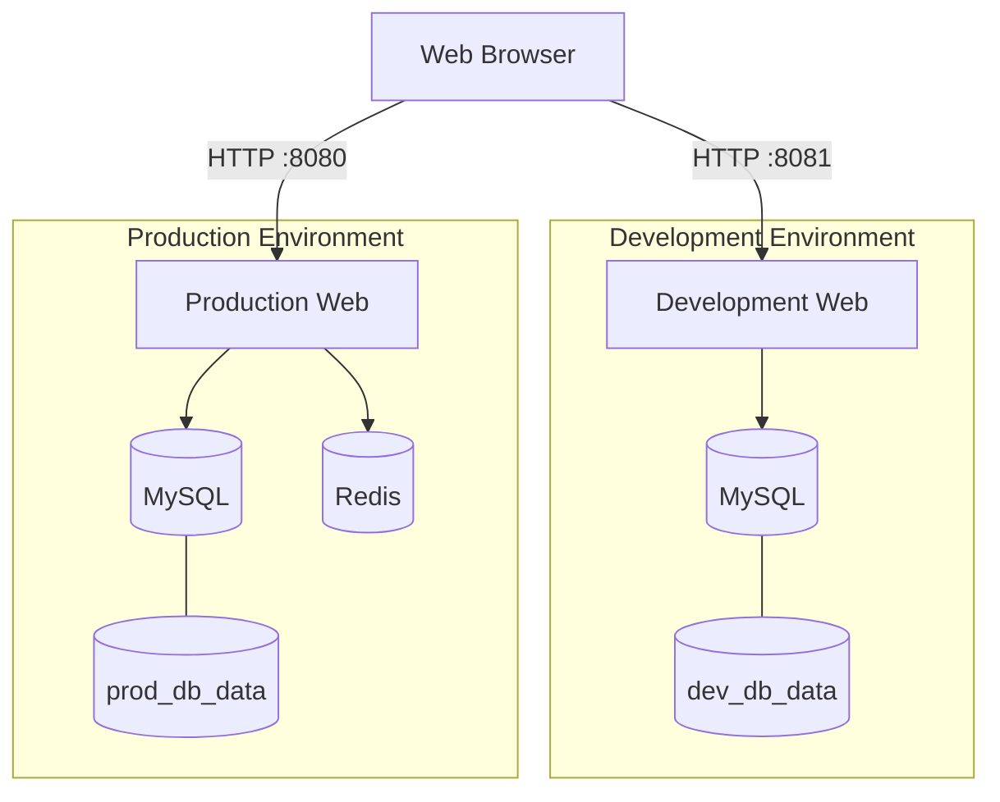

# StreamForge — Multi-Environment Deployment

StreamForge is a containerized web application for browsing and streaming video content. This project demonstrates how to deploy a multi-service application in separate development and production environments using Docker Compose.

## Features

- Video catalogue with search and category filtering.
- User authentication and role-based access for regular users and administrators.
- Video playback.
- MySQL for persistent application data.
- Redis caching and session storage in production.
- Independent development and production environments.
- Healthchecks and service status monitoring.
- Automated deployment using a Makefile.

## Architecture



Each environment has its own Docker Compose project, configuration file, database container, and persistent database volume. Production additionally uses Redis for caching and session storage.

Services communicate over their internal Docker networks. Only the web application ports are published to the host.

## Requirements

- Docker Engine
- Docker Compose v2
- GNU Make

Node.js and npm do not need to be installed on the host because the application dependencies are installed inside the Docker images.

## Installation and Quick Start

1. Clone the repository or download and extract the project ZIP.
2. Open a terminal in the project root.
3. Create the environment files `.env.dev` and `.env.prod` using the examples below.
4. Ensure Docker is running.
5. Run:

```bash
make install
```

This checks the Docker prerequisites, builds both application images, and starts both environments.

Access the application:

- **Development:** http://localhost:8081
- **Production:** http://localhost:8080

Check the container status and health endpoints:

```bash
make ps
curl -i http://localhost:8081/health
curl -i http://localhost:8080/health
```

## Environments

| Feature | Development | Production |
|---|---|---|
| Compose file | `docker-compose.dev.yml` | `docker-compose.prod.yml` |
| Environment file | `.env.dev` | `.env.prod` |
| Compose project | `streamforge-dev` | `streamforge-prod` |
| Web port | `8081` | `8080` |
| Database | MySQL 8.0 | MySQL 8.0 |
| Redis | Not configured | Enabled |
| Session storage | Express memory store | Redis |
| Database volume | `dev_db_data` | `prod_db_data` |

The environments are isolated using different Compose project names, avoiding resource-name conflicts and allowing them to be managed independently.

## Environment Configuration

The application uses separate environment files for development and production. The following values are examples for local demonstration only.

### `.env.dev`

```dotenv
APP_PORT=8081

MYSQL_HOST=db
MYSQL_PORT=3306
MYSQL_DATABASE=streamforge
MYSQL_USER=streamforge
MYSQL_PASSWORD=devpass
MYSQL_ROOT_PASSWORD=devrootpass

SEED_DEMO_USERS=true
NODE_ENV=development

SESSION_SECRET=replace_with_a_random_development_secret
COOKIE_SECURE=false
```

Redis is not configured in development.

### `.env.prod`

```dotenv
APP_PORT=8080

MYSQL_HOST=db
MYSQL_PORT=3306
MYSQL_DATABASE=streamforge
MYSQL_USER=streamforge
MYSQL_PASSWORD=prodpass
MYSQL_ROOT_PASSWORD=prodrootpass

REDIS_HOST=cache
REDIS_PORT=6379

SEED_DEMO_USERS=true
NODE_ENV=production

SESSION_SECRET=replace_with_a_random_production_secret
COOKIE_SECURE=false
```

`COOKIE_SECURE=false` is intended for local HTTP testing. Set it to `true` when production is served over HTTPS.

**Security:** Replace example credentials with appropriate values. Generate a different random `SESSION_SECRET` for each environment. Do not commit real secrets or production credentials to a public repository.

### Environment Variables

| Variable | Description |
|---|---|
| `APP_PORT` | Host port used to access the web application |
| `MYSQL_HOST` | MySQL hostname inside the Docker network |
| `MYSQL_PORT` | MySQL internal port |
| `MYSQL_DATABASE` | Database name |
| `MYSQL_USER` | Application database user |
| `MYSQL_PASSWORD` | Application database password |
| `MYSQL_ROOT_PASSWORD` | MySQL root password |
| `REDIS_HOST` | Redis hostname; configured only in production |
| `REDIS_PORT` | Redis internal port, normally `6379` |
| `SEED_DEMO_USERS` | Enables initialization of demo accounts |
| `NODE_ENV` | Application environment |
| `SESSION_SECRET` | Secret used by Express to sign session cookies |
| `COOKIE_SECURE` | Requires HTTPS for session cookies when set to `true` |

## Demo User Initialization

When `SEED_DEMO_USERS=true`, StreamForge automatically initializes two demo accounts if they do not already exist: an administrator and a regular user.

| Role | Email | Password |
|---|---|---|
| Administrator | `admin@admin.com` | `admin123` |
| Regular user | `usuario@usuario.com` | `usuario123` |

These accounts allow users to test the application's authentication and role-based access control without manually creating accounts.

The initialization process should avoid creating duplicate accounts when the application restarts.

**Security note:** These credentials are intended exclusively for local development and academic demonstrations. Never use them in a public or production deployment. Disable demo-user seeding and replace default credentials before exposing the application to external users.


## Caching and Sessions

### Redis Cache

Redis is enabled only in production. Video API responses are cached for 60 seconds.

The `/api/videos` endpoint returns a `source` field indicating whether the response came from MySQL or Redis. Repeating a request while the cache entry remains valid should demonstrate the use of the cache.

### User Sessions

The application uses `express-session` in both environments.

- Development stores sessions in the Node.js process memory.
- Production uses Redis to store session data.

`SESSION_SECRET` is required in both environments and is used to sign session cookies. `COOKIE_SECURE` controls whether cookies are restricted to HTTPS. Use `false` for local HTTP testing and `true` when HTTPS is configured.

## Healthchecks and Monitoring

The `/health` endpoint reports the status of the application's dependencies. The web interface displays application, database, and cache status separately.

For example, when MySQL is unavailable but Redis remains connected, the endpoint may return HTTP `503` with:

```json
{
  "status": "error",
  "database": "disconnected",
  "cache": "connected"
}
```

This indicates a dependency failure, not necessarily that the Express process has stopped responding.

Docker Compose healthchecks monitor the web application and MySQL in development, and the web application, MySQL, and Redis in production.

The web application's healthcheck uses `/health`, so it may report `unhealthy` if that endpoint returns `503` when a required dependency is unavailable.

## Testing and Verification

The following tests can be used to verify the deployment.

### 1. Service Startup

```bash
make ps
```

Check that the expected containers are running and healthy.

### 2. Database Connectivity

Execute a test SQL query against MySQL to confirm that the database accepts connections.

### 3. Data Persistence

Insert a test record into MySQL, recreate the database container, and verify that the record remains available.

The database uses named Docker volumes (`dev_db_data` and `prod_db_data`) to persist data independently of the database container's lifecycle.

For example, to recreate the production database container while preserving its volume:

```bash
docker compose -p streamforge-prod \
  --env-file .env.prod \
  -f docker-compose.prod.yml up -d --force-recreate db
```

Wait for MySQL to become healthy before verifying the record.

Do not use `docker compose down -v` during this test because it removes named volumes.

### 4. Redis Cache

Request the video catalogue twice:

```bash
curl -s http://localhost:8080/api/videos
```

The first response may come from MySQL. Repeat the request and check whether `source` changes to `redis` after the cache has been populated.

### 5. Failure Handling

Stop MySQL in production:

```bash
make stop-db-prod
```

Check the health endpoint and request the video catalogue again:

```bash
curl -i http://localhost:8080/health
curl -s http://localhost:8080/api/videos
```

If the catalogue cache entry is still valid, the application should be able to return the cached video data even though MySQL is unavailable.

Restart MySQL afterwards:

```bash
make start-db-prod
```

Refresh the health panel and confirm that the database connection recovers.

## Adding Videos

Videos must be prepared in **MPEG-DASH format** before they can be added to StreamForge.

### 1. Segment the Video

Use a DASH-compatible tool such as FFmpeg to process the original video into segments and generate the DASH manifest file, `manifest.mpd`.

The resulting media directory should contain the manifest and the associated video and audio segments.

### 2. Place the Media Files

Create a directory named `media` **at the same level as the `StreamForge` project directory**, not inside it.

The expected directory structure is:

```text
XA/
├── StreamForge/
│   ├── app/
│   ├── db/
│   ├── docker-compose.dev.yml
│   ├── docker-compose.prod.yml
│   ├── Makefile
│   └── README.md
└── media/
    └── example-video/
        ├── manifest.mpd
        ├── video segments...
        └── audio segments...
```

The directory name must be exactly `media`, because the Docker Compose configuration mounts this directory into the application container.

In the current setup, the media directory is mounted as a read-only volume at `/var/zabflix/media`. The host directory must therefore be located at `../media` relative to the StreamForge project directory.

### 3. Verify the DASH Manifest

Before adding the video to the application, check that:

- The `manifest.mpd` file exists.
- All video and audio segments referenced by the manifest are present.
- The manifest references the correct relative paths.
- The application can access the files through the configured media mount.

**Important:** Adding the media files alone may not automatically add the video to the catalogue. The corresponding video entry must also exist in the application's database.

## Makefile Commands

| Command | Description |
|---|---|
| `make install` | Check prerequisites, build images, and start both environments |
| `make setup` | Build images and start both environments |
| `make build-dev` | Build the development image |
| `make build-prod` | Build the production image |
| `make dev` | Start development |
| `make prod` | Start production |
| `make ps` | Show container status for both environments |
| `make logs-dev` | Follow development logs |
| `make logs-prod` | Follow production logs |
| `make stop-db-dev` | Stop development MySQL |
| `make start-db-dev` | Start development MySQL |
| `make stop-db-prod` | Stop production MySQL |
| `make start-db-prod` | Start production MySQL |
| `make down` | Stop and remove both Compose environments without deleting named volumes |

## Project Structure

```text
StreamForge/
├── app/
│   ├── Dockerfile
│   ├── package.json
│   ├── package-lock.json
│   ├── public/
│   │   ├── admin.html
│   │   ├── index.html
│   │   ├── login.html
│   │   ├── player.html
│   │   ├── register.html
│   │   ├── css/
│   │   │   └── styles.css
│   │   └── js/
│   │       ├── admin.js
│   │       ├── auth.js
│   │       ├── catalog.js
│   │       ├── health.js
│   │       └── player.js
│   └── src/
│       ├── app.js
│       ├── cache.js
│       ├── db.js
│       ├── middleware/
│       │   ├── requireAdmin.js
│       │   └── requireAuth.js
│       ├── repositories/
│       │   ├── categoryRepository.js
│       │   ├── userRepository.js
│       │   └── videoRepository.js
│       ├── routes/
│       │   ├── admin.js
│       │   ├── auth.js
│       │   ├── stream.js
│       │   └── videos.js
│       └── scripts/
│           └── seedDemoUsers.js
├── db/
│   └── init.sql
├── nginx/
├── docker-compose.dev.yml
├── docker-compose.prod.yml
├── .env.dev
├── .env.prod
├── .gitignore
├── Makefile
├── package.json
├── package-lock.json
└── README.md
```

### Main Components

- **`app/public/`**: Frontend pages, stylesheets, and JavaScript files for the catalogue, authentication, video player, administration panel, and health monitoring.
- **`app/src/app.js`**: Main application entry point and server configuration.
- **`app/src/cache.js`**: Redis client configuration and connection handling.
- **`app/src/db.js`**: Database connection logic.
- **`app/src/middleware/`**: Authentication and administrator authorization middleware.
- **`app/src/repositories/`**: Data access logic for users, videos, and categories.
- **`app/src/routes/`**: Application endpoints for authentication, administration, video catalogue, and streaming.
- **`app/src/scripts/seedDemoUsers.js`**: Initialization script for demonstration accounts.
- **`db/init.sql`**: SQL initialization script for the database.
- **`nginx/`**: Directory for Nginx configuration or related files.
- **`docker-compose.dev.yml`**: Development environment configuration.
- **`docker-compose.prod.yml`**: Production environment configuration.
- **`Makefile`**: Commands for building, starting, stopping, and managing the environments.
- **`.env.dev` and `.env.prod`**: Environment-specific configuration and credentials. These files should not be committed if they contain real secrets.


## AI Usage Declaration

**Tool:** ChatGPT (GPT-6).

**Purpose:** Assistance with technical documentation, deployment explanations, and preparation of testing and verification procedures.

**Scope:** README drafting and documentation. The implementation, configuration, and reported test results must be verified against the actual project.
